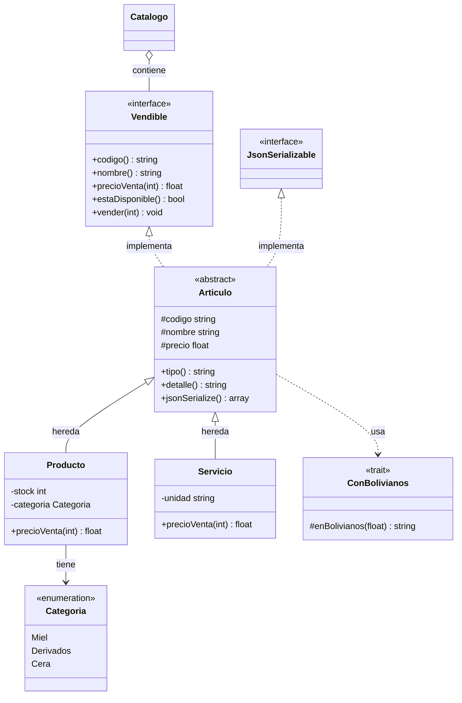

# Laboratorio 6 — Composer, herencia, interfaces, traits y enums

Nombre: Rodrigo Ledezma Sanchez · Grupo: HTML · Fecha: 14/10/2026

## Parte A — Composer y PSR-4

1. Antes de generar el autoload, el verificador informa: `Falta vendor/autoload.php. Primero ejecuta: composer dump-autoload`. Se comprobó ese resultado antes de ejecutar Composer.
2. El prefijo `Apicultores\` se asocia con `src/`; el resto del nombre se convierte en una ruta relativa de archivo.
3. `Apicultores\Modelo\Servicio` corresponde a `src/Modelo/Servicio.php`; `Apicultores\Catalogo` corresponde a `src/Catalogo.php`.
4. Usar el nombre incorrecto `Productos` produce `Class "Apicultores\Modelo\Productos" not found`. PSR-4 busca una clase y un archivo con ese nombre; la clase real se llama `Producto`, en singular.
5. `autoload.files` carga las funciones de `src/funciones.php` al requerir el autoload. PSR-4 se activa al resolver clases, interfaces, traits o enums; no carga funciones sueltas por su nombre.
6. `api.php` requiere únicamente `vendor/autoload.php`. Mantener 40 inclusiones manuales sería propenso a olvidos, orden incorrecto y duplicación entre páginas.

## Parte B — Enum

1. `descripcion()` usa `match ($this)` para devolver la descripción de Miel, Derivados o Cera.
2. `from('Hongos')` lanza `ValueError`; `tryFrom('Hongos')` devuelve `null`. Usaría `tryFrom` para una entrada de usuario que puede ser inválida y `from` cuando la validez es una condición esperada y un fallo debe detectarse.
3. El enum permite tipar los parámetros con `Categoria`, limita los valores a sus casos y reúne comportamiento como descripción y slug. Un arreglo de cadenas requiere validaciones externas repetidas.

## Parte C — Herencia y clase abstracta

1. `Producto` hereda código, nombre, precio, validación común, getters, formato monetario y serialización base de `Articulo`. Agrega categoría, socio, stock, venta controlada y precio mayorista.
2. Instanciar `Articulo` produce `Cannot instantiate abstract class Apicultores\Modelo\Articulo`. Es una base incompleta: cada hija debe proporcionar su tipo y detalle y cumplir las operaciones del contrato.
3. Desde 12 unidades, el producto aplica 10 % de descuento: 12 × 45 × 0.90 = 486. `parent::jsonSerialize()` conserva `tipo`, `codigo`, `nombre` y `precio`, que antes faltaban en el JSON de los productos. La hija agrega categoría, stock y socio.
4. `parent::__construct()` inicializa y valida la parte común antes de completar las reglas específicas del producto. Es una decisión de diseño para que las validaciones comunes no se dupliquen.

## Parte D — Interfaz y polimorfismo

1. `Vendible` exige `codigo()`, `nombre()`, `precioVenta(int)`, `estaDisponible()` y `vender(int)`. `Producto` y `Servicio` cumplen el contrato a través de `Articulo` y sus implementaciones concretas.
2. `Servicio::estaDisponible()` devuelve verdadero: el modelo del laboratorio no maneja agenda o cupos. `Catalogo::servicios()` filtra con `instanceof Servicio` y reindexa el arreglo.
3. Doce mieles cuestan Bs 486,00 por el descuento mayorista de `Producto::precioVenta()`. Doce participantes cuestan Bs 2.400,00 porque `Servicio::precioVenta()` multiplica sin descuento. PHP resuelve el método según la clase real del objeto, aunque el catálogo lo reciba como `Vendible`.
4. Pasar `new DateTime()` a `agregar(Vendible $articulo)` lanza `TypeError`: no implementa `Vendible`.

## Parte E — Trait

1. `ConBolivianos` aporta el método `enBolivianos()` reutilizable. Es `protected` para que la clase y sus hijas lo utilicen internamente; el método público `precioFormateado()` expone el resultado.
2. Un trait comparte implementación entre clases sin crear una relación «es un». Una clase solo puede extender una clase padre, pero puede utilizar varios traits. Un trait no se instancia y no reemplaza un contrato de interfaz.

## Parte F — Verificación

`php verificar.php`: **14 de 14 comprobaciones**. La demo calcula un pedido mixto de Bs 636,00. La página muestra 6 productos y 2 servicios, 7 disponibles y un inventario físico de Bs 5.030,00. `/api.php` entrega JSON con los ocho artículos, incluyendo los campos heredados.

## Reflexión — Diagrama contrastado con el código

El catálogo opera sobre el contrato y no necesita decidir el precio mediante condicionales por tipo. El trait se usa en `Articulo`, y sus hijas reciben ese comportamiento por herencia. Los servicios no suman al inventario físico.
